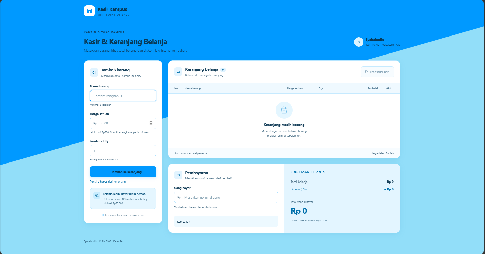
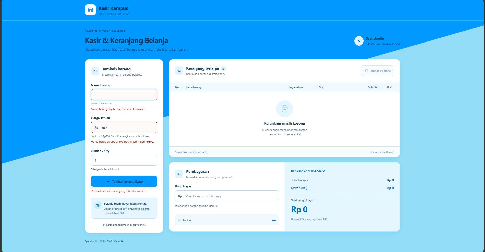
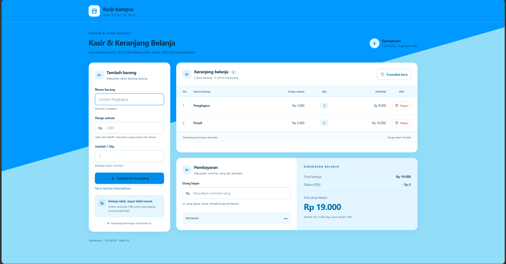

# Kasir & Keranjang Belanja Sederhana (Mini POS)

## Identitas

- Nama: Syehabudin
- NIM: 124140102
- Kelas praktikum: RA
- Pertemuan: 1

## Deskripsi aplikasi

Pada tugas ini, saya menggunakan studi kasus kasir di kantin atau toko kampus. Aplikasi Mini POS digunakan untuk memasukkan barang ke keranjang, menghitung total belanja dan diskon, serta menghitung kembalian dari uang pembayaran.

Aplikasi dibuat menggunakan HTML, CSS, dan JavaScript dengan tampilan berwarna biru, cyan, dan putih. Tujuannya adalah menerapkan materi validasi input, perhitungan otomatis, manipulasi DOM, dan penyimpanan data menggunakan `localStorage`.

## Cara menjalankan

### Melalui browser

1. Buka folder `Syehabudin_124140102_pertemuan1`.
2. Klik dua kali `index.html` untuk membukanya di browser.
3. Isi nama barang, harga satuan, dan jumlah. Harga ditulis tanpa titik ribuan, misalnya `3000`.
4. Klik **Tambah ke keranjang**.
5. Isi **Uang bayar** untuk menghitung kembalian.

### Melalui Live Server

1. Buka folder proyek di VS Code melalui **File > Open Folder**.
2. Pastikan ekstensi **Live Server** sudah terpasang.
3. Klik kanan `index.html`, kemudian pilih **Open with Live Server**.

Aplikasi kasir dapat digunakan tanpa internet. Data keranjang disimpan pada browser yang digunakan. Untuk mencoba latihan, buka `modul/index.html`; khusus latihan API membutuhkan koneksi internet.

## Checklist fitur

### Validasi input

- [x] Nama barang wajib diisi dan minimal 3 karakter.
- [x] Harga satuan harus berupa angka lebih dari Rp500.
- [x] Qty harus berupa bilangan bulat minimal 1.
- [x] Input yang salah menampilkan pesan merah dan tidak ditambahkan ke keranjang.
- [x] Form dikosongkan setelah barang berhasil ditambahkan.

### Perhitungan belanja dan pembayaran

- [x] Subtotal dihitung dari harga satuan dikali Qty.
- [x] Total belanja dihitung dari seluruh subtotal.
- [x] Diskon otomatis 10% jika total belanja minimal Rp50.000.
- [x] Nominal diskon dan total akhir ditampilkan dalam format Rupiah.
- [x] Kembalian dihitung dari uang bayar dikurangi total akhir.
- [x] Pembayaran yang kurang menampilkan pesan bahwa uang belum mencukupi.

### Keranjang dan penyimpanan

- [x] Tabel berisi No., Nama Barang, Harga Satuan, Qty, Subtotal, dan Aksi.
- [x] Setiap barang dapat dihapus dan hasil perhitungan langsung diperbarui.
- [x] Keranjang disimpan dengan `JSON.stringify()` dan dimuat dengan `JSON.parse()`.
- [x] Data keranjang tetap tersedia setelah halaman di-refresh selama penyimpanan browser diizinkan.
- [x] Tombol **Transaksi baru** mengosongkan keranjang, form, uang bayar, dan data keranjang di `localStorage`.
- [x] HTML, CSS, dan JavaScript dipisahkan ke file masing-masing.
- [x] Tampilan menyesuaikan ukuran layar dan tabel dapat digeser pada layar kecil.

## Contoh transaksi

| Nama barang | Harga satuan | Qty | Subtotal |
| --- | ---: | ---: | ---: |
| Penghapus | Rp3.000 | 3 | Rp9.000 |
| Pensil | Rp5.000 | 2 | Rp10.000 |

Total belanja adalah **Rp19.000**. Karena belum mencapai Rp50.000, diskonnya **Rp0** dan total akhirnya tetap **Rp19.000**.

Jika uang bayar diisi `20000`, kembalian yang dihasilkan adalah **Rp1.000**. Pada screenshot hasil perhitungan, uang bayar masih kosong sehingga kembalian belum ditampilkan.

### Contoh transaksi dengan diskon

| Nama barang | Harga satuan | Qty | Subtotal |
| --- | ---: | ---: | ---: |
| Penghapus | Rp3.000 | 10 | Rp30.000 |
| Pensil | Rp5.000 | 15 | Rp75.000 |

Total belanja adalah **Rp105.000**. Karena sudah mencapai Rp50.000, aplikasi memberikan diskon **10% sebesar Rp10.500**, sehingga total yang dibayar menjadi **Rp94.500**.

Jika uang bayar diisi `100000`, kembalian yang dihasilkan adalah **Rp5.500**. Pada screenshot diskon, uang bayar belum diisi sehingga kembalian belum ditampilkan.

## Penjelasan teknis singkat

1. `validasiBarang()` memeriksa nama, harga, dan Qty sebelum barang dimasukkan. Pesan kesalahan ditampilkan melalui `setError()`.
2. Barang yang valid ditambahkan ke array `keranjang`, lalu `tampilkanKeranjang()` menampilkan datanya pada tabel menggunakan DOM.
3. `hitungBelanja()` menjumlahkan subtotal dengan `reduce()`, menghitung diskon, dan menentukan total akhir.
4. `hitungPembayaran()` memeriksa uang bayar untuk menampilkan kembalian atau kekurangan pembayaran.
5. `simpanKeranjang()` menyimpan data sebagai JSON di `localStorage`. Saat halaman dibuka kembali, `muatKeranjang()` membaca data tersebut.
6. Tombol **Hapus** memperbarui keranjang dan perhitungan. Tombol **Transaksi baru** menghapus data keranjang melalui `localStorage.removeItem()`.

Uang bayar tidak disimpan. Data keranjang hanya tersimpan di browser tanpa menggunakan database. Jika penyimpanan tidak tersedia atau data tersimpan rusak, aplikasi menampilkan pesan.

## Struktur file

Folder proyek: `Syehabudin_124140102_pertemuan1`.

| File atau folder | Keterangan |
| --- | --- |
| `index.html` | Form input, tabel keranjang, pembayaran, dan ringkasan belanja. |
| `style.css` | Tampilan aplikasi dan penyesuaian ukuran layar. |
| `script.js` | Validasi, perhitungan, pengelolaan keranjang, dan penyimpanan. |
| `README.md` | Dokumentasi tugas. |
| `modul/` | Latihan dari materi praktikum. |
| `screenshot/` | Gambar tampilan aplikasi. |

### Latihan modul

| Folder | Materi latihan |
| --- | --- |
| `01-variabel-kondisional/` | Variabel, biodata, dan percabangan. |
| `02-loop-fungsi/` | Perulangan dan fungsi. |
| `03-array-objek/` | Data mahasiswa, perhitungan nilai, filter, dan pengurutan. |
| `04-dom-api/` | Manipulasi DOM dan pengambilan data API. |
| `05-form-todo-localstorage/` | Form Todo, status selesai, hapus, dan penyimpanan. |

Setiap folder latihan berisi `index.html` dan `script.js`. Tampilan latihan menggunakan `modul/style.css`, sedangkan `modul/index.html` menjadi menu untuk memilih latihan. Latihan API menggunakan data dari JSONPlaceholder.

## Screenshot aplikasi

### 1. Tampilan utama

Tampilan form input barang dengan keranjang kosong, pembayaran, dan ringkasan belanja.

### 2. Tampilan ketika error

Nama barang diisi `p` dan harga diisi `480`. Pesan merah muncul karena nama kurang dari 3 karakter dan harga harus lebih dari Rp500. Barang tidak masuk ke keranjang.

### 3. Hasil perhitungan

Keranjang berisi Penghapus dan Pensil dengan total belanja Rp19.000, sesuai contoh transaksi di atas.

### 4. Hasil perhitungan dengan diskon

Keranjang berisi Penghapus sebanyak 10 unit dan Pensil sebanyak 15 unit. Total belanja Rp105.000, diskon 10% sebesar Rp10.500, dan total yang dibayar Rp94.500. Uang bayar belum diisi pada tampilan ini.

