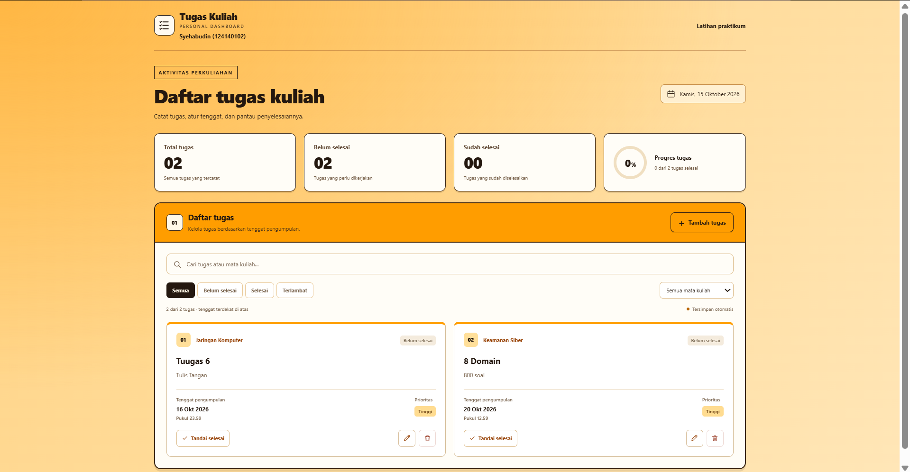
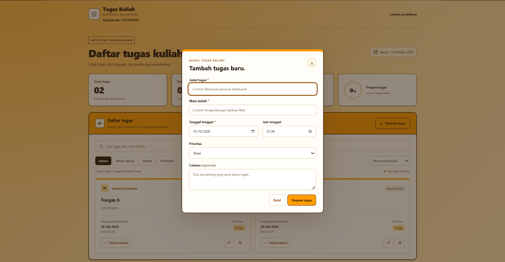
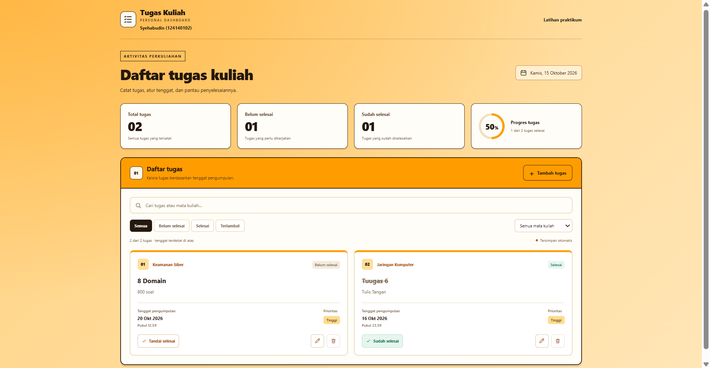

# Daftar Tugas Kuliah

## Identitas

- Nama: Syehabudin
- NIM: 124140102
- Kelas praktikum: RA
- Pertemuan: 2

## Tentang aplikasi

Pada praktikum pertemuan 2 ini, saya membuat personal dashboard berupa daftar tugas kuliah. Aplikasi ini digunakan untuk mencatat tugas dari beberapa mata kuliah, melihat tenggat pengumpulan, dan menandai tugas yang sudah selesai.

Saya menggunakan HTML, CSS, dan JavaScript ES6+. Tampilannya memakai warna oranye dan krem. Data tugas disimpan di `localStorage`, jadi tugas yang sudah dimasukkan tetap ada saat halaman di-refresh pada browser dan alamat yang sama.

## Fitur

- Menambah, mengedit, dan menghapus tugas.
- Mengisi mata kuliah, tanggal dan jam tenggat, prioritas, serta catatan.
- Menandai tugas selesai atau mengembalikannya ke status belum selesai.
- Mencari tugas dan memfilter berdasarkan status atau mata kuliah.
- Mengurutkan tugas yang belum selesai dari tenggat terdekat.
- Menampilkan jumlah tugas dan persentase progres.
- Menyimpan tugas secara otomatis di browser.

Saat pertama dibuka, aplikasi menyediakan beberapa tugas contoh. Data contoh tersebut bisa diedit atau dihapus.

## Cara menjalankan

1. Buka folder `Syehabudin_124140102_pertemuan2` di VS Code.
2. Pasang ekstensi **Live Server** jika belum tersedia.
3. Klik kanan `index.html`, lalu pilih **Open with Live Server**.
4. Klik **Tambah tugas**, isi formulir, kemudian klik **Simpan tugas**.

Gunakan ikon pensil untuk mengedit, ikon tempat sampah untuk menghapus, dan tombol **Tandai selesai** untuk mengubah status tugas. Latihan materi bisa dibuka dari tautan **Latihan praktikum** atau melalui `praktikum/index.html`.

Aplikasi perlu dijalankan lewat Live Server karena menggunakan ES module dan membaca file JSON melalui `fetch()`.

## Penggunaan ES6+

Berikut bagian kode yang saya gunakan untuk menerapkan materi pertemuan 2.

| Fitur | Letak kode | Penggunaan |
| --- | --- | --- |
| `let` dan `const` | `js/main.js`, baris 5 dan 7 | Menyimpan referensi elemen dan data pilihan mata kuliah. |
| Arrow functions | `js/main.js`, baris 25, 41, dan 50 | Membuat kartu tugas dan memperbarui tampilan. |
| Template literals | `js/main.js`, baris 31 | Menyusun HTML kartu berdasarkan data tugas. |
| Class | `js/app.js`, baris 5 dan 27 | `TaskItem` untuk data tugas dan `DashboardApp` untuk mengelola aplikasi. |
| `async/await` | `js/app.js`, baris 132 dan 145 | Mengambil pilihan mata kuliah dari file JSON. |
| Destructuring | `js/main.js`, baris 26 | Mengambil properti dari objek tugas. |
| Spread operator | `js/app.js`, baris 75 dan 81 | Menambah atau mengubah tugas menggunakan array dan objek baru. |
| Rest syntax | `js/main.js`, baris 92 | Memisahkan ID dari data formulir. |
| `localStorage` | `js/app.js`, baris 45 dan 66 | Membaca dan menyimpan data tugas dalam bentuk JSON. |
| ES module | `js/main.js`, baris 1-2 | Mengimpor class dan fungsi dari file lain. |

Pilihan mata kuliah diambil dari `js/modules/mata-kuliah.json`. Pengguna juga bisa mengetik mata kuliah lain. Jika file JSON gagal dibaca, aplikasi memakai mata kuliah dari tugas yang sudah tersimpan.

## Pembagian file

| File atau folder | Isi |
| --- | --- |
| `index.html` | Halaman dashboard dan formulir tugas. |
| `css/style.css` | Tampilan halaman dan pengaturan untuk layar kecil. |
| `js/main.js` | Tombol, formulir, pencarian, filter, dan tampilan tugas. |
| `js/app.js` | Class, validasi, pengelolaan tugas, dan penyimpanan. |
| `js/modules/data.js` | Data contoh dan kunci penyimpanan. |
| `js/modules/utils.js` | Fungsi pembantu untuk tanggal, status, dan teks. |
| `js/modules/mata-kuliah.json` | Pilihan mata kuliah untuk formulir. |
| `praktikum/` | Latihan materi pertemuan 2. |
| `screenshot/` | Screenshot hasil penggunaan aplikasi. |

## Latihan praktikum

Selain tugas dashboard, saya menyertakan latihan pada folder `praktikum/`. Setiap topik memiliki file HTML dan JavaScript sendiri. Menu latihannya ada di `praktikum/index.html`.

| Folder | Materi latihan |
| --- | --- |
| `01-let-const-arrow/` | Scope variabel, objek const, dan bentuk arrow function. |
| `02-template-literals/` | Interpolasi, multiline, dan pembuatan HTML dari string. |
| `03-destructuring-spread-rest/` | Objek bertingkat, statistik dengan rest, penggabungan objek, dan for...of. |
| `04-classes-object-literals/` | Product, DigitalProduct, PhysicalProduct, getter/setter, dan default parameter. |
| `05-modern-array-methods/` | groupBy, rata-rata, flatten, dan gabungan filter-map-reduce. |
| `06-async-programming/` | Penggabungan data, retry, loading, penanganan error, pagination, dan debounce. |

Latihan async menyediakan pilihan data lokal dan API JSONPlaceholder. Mode lokal bisa dipakai tanpa internet. Untuk mencoba API online, gunakan koneksi internet. Simulasi kegagalan jaringan juga tersedia untuk melihat proses retry dan pesan error.

## Screenshot aplikasi

### 1. Tampilan utama

Pada contoh ini ada dua tugas dari mata kuliah Jaringan Komputer dan Keamanan Siber. Keduanya belum selesai sehingga progresnya masih 0%.

### 2. Formulir tambah tugas

Formulir ini digunakan untuk mengisi data tugas baru. Screenshot diambil sebelum formulir diisi.

### 3. Tugas selesai

Setelah tugas Jaringan Komputer ditandai selesai, jumlah tugas selesai menjadi satu dari dua tugas. Progresnya berubah menjadi 50%.

## Pengujian

Pengujian logika menggunakan Node.js menghasilkan **32 skenario lulus**, yaitu 17 untuk dashboard dan 15 untuk latihan. Bagian yang diperiksa meliputi pengelolaan tugas, penyimpanan, validasi, filter, dan proses async. Respons API online menggunakan simulasi, sedangkan JSON lokal dibaca dari file aslinya.

Screenshot di atas menunjukkan tampilan saat aplikasi digunakan. Pengujian browser secara otomatis belum dilakukan.
