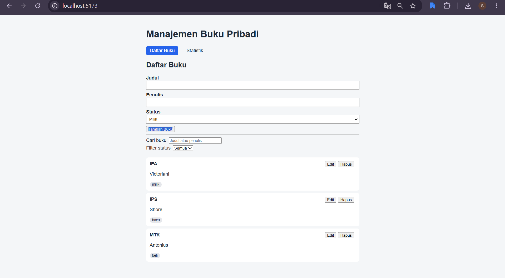
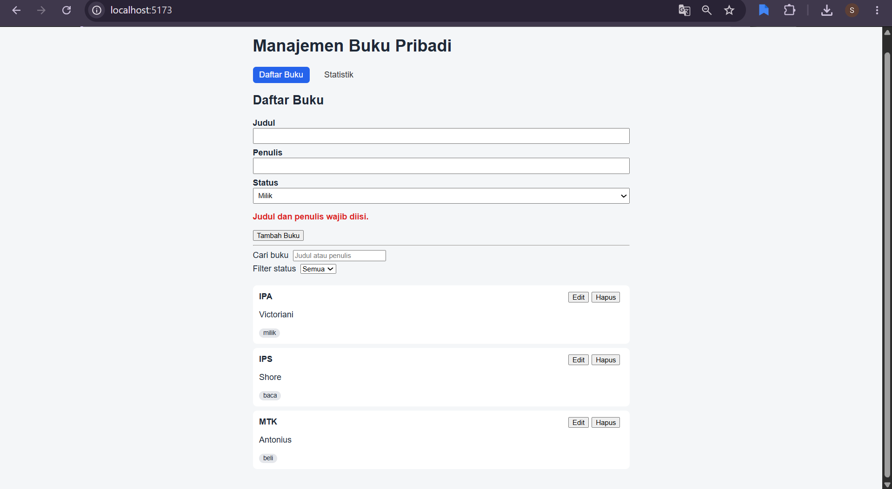
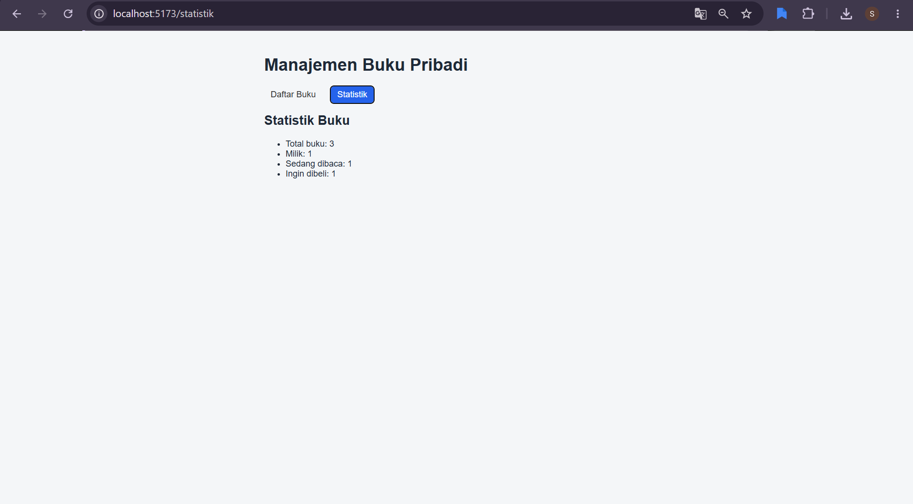
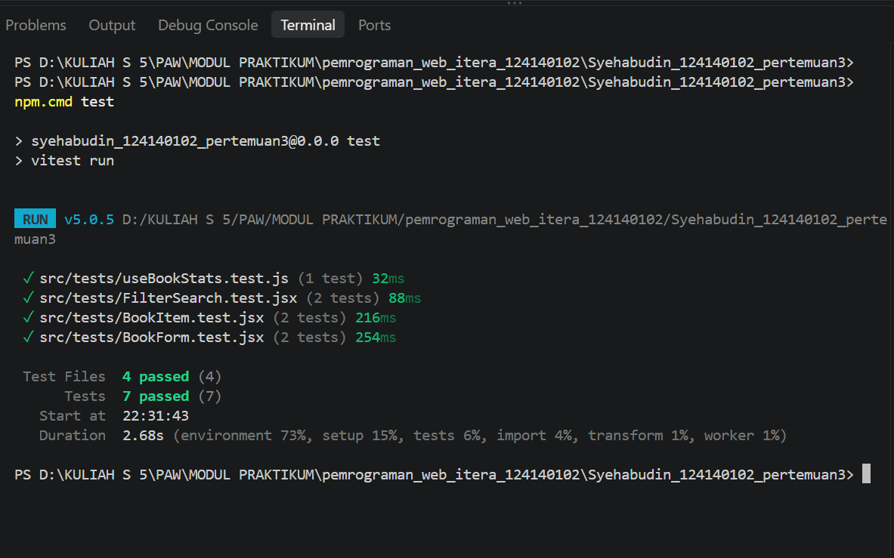

# Manajemen Buku Pribadi

- Nama: Syehabudin
- NIM: 124140102
- Kelas praktikum: RA
- Pertemuan: 3

## Deskripsi Aplikasi

Aplikasi web untuk mencatat buku pribadi. Setiap buku punya judul, penulis, dan status (**milik**, **baca**, atau **beli**). Dibuat dengan React + Vite.

## Fitur

- Tambah buku dengan validasi (judul dan penulis tidak boleh kosong, pesan error terlihat)
- Edit dan hapus buku
- Filter berdasarkan status buku
- Pencarian berdasarkan judul atau nama penulis
- Halaman statistik (total, milik, baca, beli)
- Data tersimpan di `localStorage`, tetap ada setelah halaman di-refresh

## Cara Instalasi dan Menjalankan

```bash
cd Syehabudin_124140102_pertemuan3
npm install
npm run dev
```

Buka alamat yang muncul di terminal (biasanya `http://localhost:5173/`).

Menjalankan unit test:

```bash
npm test
```

## Screenshot

### Daftar Buku


### Validasi Formulir


### Statistik


### Hasil Unit Test


## Konsep React yang Digunakan

- **useState**: menyimpan isi form, kata kunci pencarian, filter status, dan ID buku yang sedang diedit.
- **useEffect**: dipakai di `useLocalStorage` untuk menyimpan data ke `localStorage` setiap kali nilainya berubah.
- **Context API**: `BookContext` menyediakan daftar buku, statistik, serta fungsi tambah, edit, dan hapus ke semua halaman lewat hook `useBooks`.
- **React Router**: `react-router-dom` mengatur dua halaman, yaitu Daftar Buku (`/`) dan Statistik (`/statistik`).
- **Custom hooks**: `useLocalStorage` (penyimpanan permanen) dan `useBookStats` (menghitung statistik buku).
- **Komponen reusable**: `BookForm`, `BookItem`, `BookList`, `BookFilter`, dan `SearchBar`. `BookForm` dipakai untuk tambah sekaligus edit.
- **PropTypes**: setiap komponen memvalidasi props yang diterima.
- **Unit test**: 7 test dengan Vitest dan React Testing Library mencakup form, hook statistik, item buku, filter, dan pencarian.
