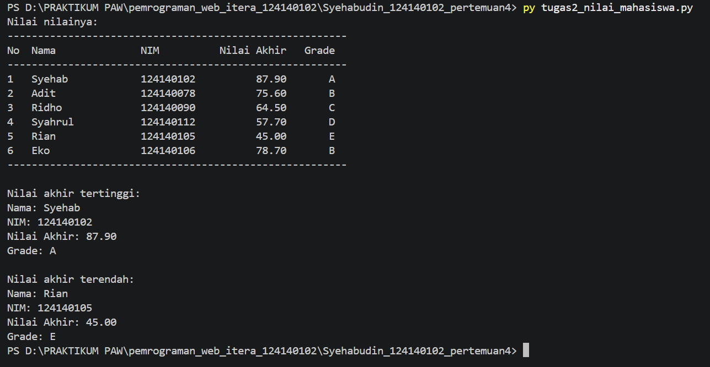
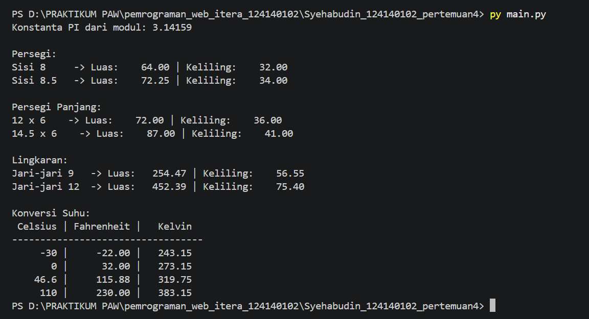

# Python Dasar

Folder ini berisi tugas pertemuan 4 mata kuliah Pemrograman Aplikasi Web di Institut Teknologi Sumatera, yaitu program Python untuk menghitung BMI, mengolah nilai mahasiswa, dan membuat modul matematika.

## Identitas

- Nama: Syehabudin
- NIM: 124140102
- Kelas praktikum: RA
- Petemuan: 4

## Deskripsi program

### 1. `tugas1_bmi.py` - Penghitung BMI

Program meminta input berat badan (kg) dan tinggi badan (m), lalu menghitung BMI dengan rumus `berat / (tinggi * tinggi)`. Kategori ditentukan dengan `if-elif-else` (berat badan kurang, normal, berlebih, atau obesitas). Nilai BMI dicetak dengan 2 angka desimal.

### 2. `tugas2_nilai_mahasiswa.py` - Pengelolaan nilai mahasiswa

Program menyimpan 6 data mahasiswa dalam list berisi dictionary, lalu menghitung nilai akhir (30% UTS + 40% UAS + 30% Tugas) dan menentukan grade A sampai E. Hasilnya dicetak dalam tabel dengan perataan f-string, disertai data mahasiswa dengan nilai akhir tertinggi dan terendah.

### 3. `math_operations.py` dan `main.py` - Modul matematika

- `math_operations.py`: konstanta `PI`, fungsi luas dan keliling (persegi, persegi panjang, lingkaran), serta konversi suhu (Celsius ke Fahrenheit dan Celsius ke Kelvin).
- `main.py`: mengimpor modul dengan 2 cara (`import math_operations` dan `from math_operations import ...`), lalu memanggil seluruh fungsi dengan berbagai nilai uji.

### Latihan

Latihan mandiri ditempatkan di folder [`Latihan`](Latihan/).

## Cara menjalankan

Pastikan Python 3.8 atau lebih baru sudah terpasang, lalu buka terminal di folder ini:

```bash
py tugas1_bmi.py
py tugas2_nilai_mahasiswa.py
py main.py
```

Gunakan `python` atau `python3` jika `py` tidak tersedia.

## Screenshot hasil eksekusi

### Soal 1, Program Penghitung BMI (Body Mass Index) Sederhana `tugas1_bmi.py`
Kategori berat badan normal dan berat badan kurang:


Kategori berat badan berlebih dan obesitas:


### Soal 2, Program Pengelolaan Data Nilai Mahasiswa `tugas2_nilai_mahasiswa.py`


### Soal 3, Modul Matematika Python & Program Penggunaannya `main.py`
