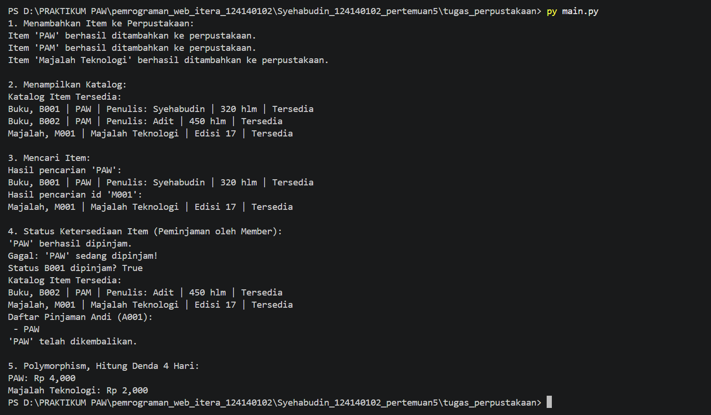

# Python OOP

Folder ini berisi tugas pertemuan 5 mata kuliah Pemrograman Aplikasi Web di Institut Teknologi Sumatera, yaitu latihan hands-on konsep OOP Python dan program sistem manajemen perpustakaan sederhana.

## Identitas

- Nama: Syehabudin
- NIM: 124140102
- Kelas praktikum: RA
- Pertemuan: 5

## Deskripsi program

### Tugas: Sistem Manajemen Perpustakaan Sederhana (`tugas_perpustakaan/`)

Program mengelola koleksi item perpustakaan yang terdiri dari buku dan majalah. Alur programnya (`main.py`):

1. Membuat objek `Library`, lalu menambahkan dua buku dan satu majalah.
2. Menampilkan katalog item yang tersedia.
3. Mencari item berdasarkan judul dan berdasarkan id.
4. Meminjam dan mengembalikan item lewat objek `Member`, lalu memperlihatkan perubahan status ketersediaan di katalog.
5. Menghitung denda keterlambatan untuk buku dan majalah.

Berkas yang digunakan:

- `library_item.py`: abstract class `LibraryItem` beserta subclass `Book` dan `Magazine`.
- `member.py`: class `Member` untuk anggota yang meminjam dan mengembalikan item.
- `library.py`: class `Library` untuk menyimpan dan mengelola koleksi item.
- `main.py`: skrip untuk menguji seluruh fungsionalitas sistem.

### Penerapan 4 pilar OOP

- **Class:** `LibraryItem`, `Book`, `Magazine`, `Member`, dan `Library` masing-masing mewakili satu entitas nyata di perpustakaan, lalu dibuat objeknya di `main.py`.
- **Inheritance:** `Book` dan `Magazine` mewarisi `LibraryItem` dan memanggil constructor parent lewat `super().__init__()`. Atribut dan method umum (id, judul, status peminjaman, `pinjam()`, `kembalikan()`) ditulis sekali di `LibraryItem`.
- **Encapsulation:** `_id_item` dan `_judul` bersifat protected, sedangkan `__dipinjam` (di `LibraryItem`), `__koleksi` (di `Library`), dan `__daftar_pinjam` (di `Member`) bersifat private sehingga tidak bisa diubah langsung dari luar class. Data dibaca lewat `@property` `id_item`, `judul`, dan `is_dipinjam`.
- **Polymorphism:** `LibraryItem` mendefinisikan abstract method `get_detail()` dan `hitung_denda()`. `Book` dan `Magazine` mengimplementasikannya dengan cara berbeda (denda buku Rp 1.000 per hari, denda majalah Rp 500 per hari), tetapi dipanggil dengan cara yang sama dalam satu loop di `main.py`.

### Latihan

- [`praktikum/latihan`](praktikum/latihan/): file hands-on dari modul, yaitu `01_everything_is_object.py`, `01_procedural_vs_oop.py`, `02_class_object.py`, `03_inheritance.py`, `04_encapsulation.py`, `05_polymorphism.py`, dan `06_abstract_class.py`.
- [`praktikum/latihan_mandiri`](praktikum/latihan_mandiri/): latihan mandiri dari modul, yaitu `kasir_toko.py`, `latihan_buku.py`, `latihan_truk.py`, `latihan_karyawan.py`, `latihan_notifikasi.py`, dan `latihan_storage.py`, beserta folder dokumentasinya.

## Cara menjalankan

Pastikan Python 3.10 atau lebih baru sudah terpasang, lalu buka terminal di folder `tugas_perpustakaan`:

```bash
py main.py
```

Gunakan `python main.py` atau `python3 main.py` jika `py` tidak tersedia.

## Screenshot hasil eksekusi

### Tugas Sistem Manajemen Perpustakaan Sederhana `main.py`
Penambahan item, penampilan katalog, pencarian item, status ketersediaan, dan perhitungan denda:
